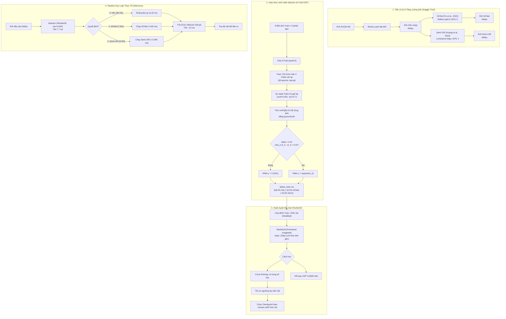

# Giải Thích Logic Kỹ Thuật và Trạng Thái Dự Án
## Selective Underwater Image Enhancement for Object Detection with YOLO11

> **Tài liệu tổng hợp toàn diện:** Bối cảnh học thuật, mục đích nghiên cứu, toàn bộ logic kỹ thuật, cấu trúc mã nguồn, kết quả thực nghiệm chi tiết và các phát hiện khoa học tính đến thời điểm hiện tại.
> 
> **Tác giả dự án:** Nguyễn Quốc Bảo & Phan Lê Văn Minh  
> **Đơn vị:** Trường Đại học Bách khoa – Đại học Đà Nẵng  
> **Mã nguồn:** [GitHub Repository](https://github.com/bao-nguyen-quoc/computer-vision-underwater-image-enhancer)  
> **Tập dữ liệu chuẩn hóa:** [phanlvnminh/ruod640 trên Kaggle](https://www.kaggle.com/datasets/phanlvnminh/ruod640)

---

## MỤC LỤC
1. [Giới Thiệu & Bối Cảnh Nghiên Cứu](#1-giới-thiệu--bối-cảnh-nghiên-cứu)
   - [1.1. Nghịch lý giữa Tăng cường ảnh (UIE) và Nhận diện đối tượng (UOD)](#11-nghịch-lý-giữa-tăng-cường-ảnh-uie-và-nhận-diện-đối-tượng-uod)
   - [1.2. Động lực từ nghiên cứu của Awad et al. (2026)](#12-động-lực-từ-nghiên-cứu-của-awad-et-al-2026)
   - [1.3. Mục tiêu và đóng góp cốt lõi của đề tài](#13-mục-tiêu-và-đóng-góp-cốt-lõi-của-đề-tài)
2. [Toàn Bộ Logic Kỹ Thuật & Kiến Trúc Hệ Thống](#2-toàn-bộ-logic-kỹ-thuật--kiến-trúc-hệ-thống)
   - [2.1. Sơ đồ kiến trúc tổng thể](#21-sơ-đồ-kiến-trúc-tổng-thể)
   - [2.2. Các bộ tăng cường ảnh (SCNet & Semi-UIR)](#22-các-bộ-tăng-cường-ảnh-scnet--semi-uir)
   - [2.3. Bộ phát hiện đối tượng (YOLO11n)](#23-bộ-phát-hiện-đối-tượng-yolo11n)
   - [2.4. Giao thức sinh nhãn Out-of-Fold (K-Fold 3-way)](#24-giao-thức-sinh-nhãn-out-of-fold-k-fold-3-way)
   - [2.5. Bộ chọn thích ứng ResNet18 (Selector Architecture & Decision Rules)](#25-bộ-chọn-thích-ứng-resnet18-selector-architecture--decision-rules)
   - [2.6. Quy trình đánh giá phi rò rỉ (Zero-leakage Evaluation via Saved Predictions)](#26-quy-trình-đánh-giá-phi-rò-rỉ-zero-leakage-evaluation-via-saved-predictions)
   - [2.7. Phân tích nền nhiễu Oracle (Oracle Noise Floor Formulation)](#27-phân-tích-nền-nhiễu-oracle-oracle-noise-floor-formulation)
   - [2.8. Hợp nhất hộp phán đoán (Weighted Boxes Fusion - WBF)](#28-hợp-nhất-hộp-phán-đoán-weighted-boxes-fusion---wbf)
   - [2.9. Phân tích Detector Đơn miền vs. Đa miền (Domain Detectors Matrix)](#29-phân-tích-detector-đơn-miền-vs-đa-miền-domain-detectors-matrix)
3. [Cấu Trúc Thư Mục & Mã Nguồn](#3-cấu-trúc-thư-mục--mã-nguồn)
4. [Kết Quả Thực Nghiệm Chi Tiết](#4-kết-quả-thực-nghiệm-chi-tiết)
   - [4.1. Kiểm chứng chất lượng UIE trên tập UIEB (90 ảnh)](#41-kiểm-chứng-chất-lượng-uie-trên-tập-uieb-90-ảnh)
   - [4.2. Kết quả K-Fold & Phân bố nhãn Selector trên tập train RUOD (9.800 ảnh)](#42-kết-quả-k-fold--phân-bố-nhãn-selector-trên-tập-train-ruod-9800-ảnh)
   - [4.3. Kết quả phát hiện vật thể trên tập test RUOD (4.200 ảnh)](#43-kết-quả-phát-hiện-vật-thể-trên-tập-test-ruod-4200-ảnh)
   - [4.4. Đánh giá chi tiết Selector ResNet18](#44-đánh-giá-chi-tiết-selector-resnet18)
   - [4.5. Phân tích nền nhiễu Oracle: Tại sao Selector không thể vượt trội?](#45-phân-tích-nền-nhiễu-oracle-tại-sao-selector-không-thể-vượt-trội)
   - [4.6. Hiệu quả của các phương pháp thực tế: WBF & Heuristics](#46-hiệu-quả-của-các-phương-pháp-thực-tế-wbf--heuristics)
   - [4.7. Ma trận Detector Đơn miền vs. Đa miền (Kiểm chứng giả thuyết Awad et al.)](#47-ma-trận-detector-đơn-miền-vs-đa-miền-kiểm-chứng-giả-thuyết-awad-et-al)
5. [Các Phát Hiện Khoa Học Cốt Lõi (Key Scientific Findings)](#5-các-phát-hiện-khoa-học-cốt-lõi-key-scientific-findings)
6. [Trạng Thái Hiện Tại & Đánh Giá So Với Kế Hoạch](#6-trạng-thái-hiện-tại--đánh-giá-so-với-kế-hoạch)
   - [6.1. Tiến độ so với kế hoạch ban đầu](#61-tiến-độ-so-với-kế-hoạch-ban-đầu)
   - [6.2. Trạng thái bài báo khoa học (IEEE Conference Paper)](#62-trạng-thái-bài-báo-khoa-học-ieee-conference-paper)
   - [6.3. Hạn chế và các bước triển khai tiếp theo](#63-hạn-chế-và-các-bước-triển-khai-tiếp-theo)

---

## 1. Giới Thiệu & Bối Cảnh Nghiên Cứu

### 1.1. Nghịch lý giữa Tăng cường ảnh (UIE) và Nhận diện đối tượng (UOD)
Hình ảnh chụp dưới nước chịu ảnh hưởng nghiêm trọng bởi hiện tượng hấp thụ và tán xạ ánh sáng phụ thuộc vào bước sóng. Ánh sáng đỏ bị suy giảm nhanh nhất, tiếp theo là xanh lục và xanh lam, dẫn đến hiện tượng ám màu nặng (color cast - thường là xanh dương hoặc xanh lá), độ tương phản thấp (low contrast), giảm chi tiết biên cạnh và độ mờ đục do huyền phù trong nước (turbidity/haze).

Để giải quyết vấn đề này, các mô hình **Tăng cường ảnh dưới nước (Underwater Image Enhancement - UIE)** như [SCNet](https://github.com/zhenqifu/SCNet) (Fu et al., 2022) và [Semi-UIR](https://github.com/Huang-ShiRui/Semi-UIR) (Huang et al., 2023) đã ra đời nhằm khôi phục chất lượng thị giác theo cảm nhận mắt người, được đo lường bằng các chỉ số như PSNR, SSIM, UIQM hay UCIQE.

Một giả định ngây thơ phổ biến trong cộng đồng nghiên cứu thị giác máy tính là: **"Ảnh trông đẹp hơn và rõ hơn đối với mắt người thì mô hình phát hiện đối tượng (Object Detection) cũng sẽ nhận diện chính xác hơn."** Do đó, UIE thường được đặt mặc định làm một bước tiền xử lý (pre-processing) độc lập trước detector.

Tuy nhiên, các thực nghiệm gần đây cho thấy:
1. **Tăng cường đồng loạt làm giảm độ chính xác:** Khi áp dụng một mô hình UIE duy nhất cho toàn bộ tập dữ liệu, điểm mAP của detector thường bị suy giảm so với việc giữ nguyên ảnh gốc. Nguyên nhân là do UIE có thể tạo ra các giả tạo hình ảnh (artifacts), làm bão hòa màu cục bộ, khuếch đại nhiễu cảm biến hoặc phá hủy các đặc trưng biên cạnh tinh vi mà detector dựa vào.
2. **Sự biến thiên cục bộ theo từng ảnh (Per-image variability):** UIE không hoàn toàn vô dụng; nó cải thiện rõ rệt những ảnh bị tối sầm hoặc mất tương phản nghiêm trọng, nhưng lại làm hỏng các ảnh vốn đã có ánh sáng tương đối tốt.

### 1.2. Động lực từ nghiên cứu của Awad et al. (2026)
Bài báo *"Revisiting Underwater Image Enhancement for Object Detection"* của Awad et al. (*Journal of Imaging, 2026*) đã kiểm tra 9 phương pháp UIE hiện đại trên các detector mạnh (như YOLO-NAS-L) trên tập dữ liệu RUOD và chỉ ra:
- Không có bất kỳ phương pháp UIE nào luôn vượt trội hơn ảnh gốc trên toàn bộ tập dữ liệu.
- **Mixed-set Upper Bound (Cận trên Oracle):** Nếu với mỗi ảnh, một "vị thần" (Oracle) biết trước nhãn thực tế để chọn phiên bản ảnh cho mAP cao nhất trong số 10 phiên bản (ảnh gốc + 9 bản UIE), mAP từng ảnh trung bình có thể tăng vọt từ **0.68 lên 0.77 (+0.09)**.

**Hạn chế chí mạng của Awad et al.:**
1. **Cận trên bất khả thi trong thực tế:** Oracle cần biết trước Ground Truth của từng ảnh để tính mAP rồi mới chọn. Họ không xây dựng được một bộ chọn thực tế (no learned selector) có thể tự động quyết định mà không cần nhãn.
2. **Nghi vấn về nguồn gốc của mức tăng:** Awad et al. huấn luyện mỗi miền ảnh một detector riêng (10 detectors khác nhau), do đó cận trên của họ gộp cả sự khác biệt ngẫu nhiên giữa các model chứ không thuần túy là tác động của ảnh. Hơn nữa, liệu mức tăng +0.09 đó có phải chỉ là nhiễu thống kê ngẫu nhiên?

### 1.3. Mục tiêu và đóng góp cốt lõi của đề tài
Dự án này được thiết kế để trả lời trực diện các câu hỏi mở trên:
1. **Xây dựng Pipeline Tăng cường Chọn lọc Thực tế (Selective Enhancement Pipeline):** Thiết kế bộ chọn nhẹ (**ResNet18**) chỉ quan sát ảnh gốc để tự động chọn giữa 3 ứng viên: **Ảnh gốc (orig), SCNet, và Semi-UIR**, đưa vào detector **YOLO11n**, đánh giá trên tập chuẩn RUOD (14.000 ảnh).
2. **Giao thức huấn luyện phi rò rỉ (Strict Leakage-Free Protocol):** Sử dụng K-Fold Out-of-Fold (OOF) để gán nhãn cho Selector từ một detector chưa từng thấy ảnh đó; tách bạch hoàn toàn tập test chỉ dùng để báo cáo cuối cùng.
3. **Giải mã bản chất của cận trên Oracle (Oracle Noise Floor Analysis):** Chứng minh bằng thực nghiệm rằng phần lớn khoảng cách cải thiện của Oracle thực chất là **nhiễu đo lường của detector (detector noise)** chứ không phải tín hiệu thị giác hữu ích.
4. **Đánh giá giải pháp thay thế:** Khảo sát phương pháp hợp nhất hộp dự đoán đa góc nhìn (**Weighted Boxes Fusion - WBF**) và chiến lược **huấn luyện đa miền (Mixed-domain training)**.

---

## 2. Toàn Bộ Logic Kỹ Thuật & Kiến Trúc Hệ Thống

### 2.1. Sơ đồ kiến trúc tổng thể



---

### 2.2. Các bộ tăng cường ảnh (SCNet & Semi-UIR)

Dự án tích hợp mã nguồn chính thức của hai mô hình UIE tiêu biểu đại diện cho hai trường phái thiết kế khác nhau, được fork về tổ chức cá nhân với các sửa đổi tối thiểu để tương thích với PyTorch hiện đại:

| Đặc tính | SCNet ([computer-vision-SCNet](https://github.com/bao-nguyen-quoc/computer-vision-SCNet)) | Semi-UIR ([computer-vision-Semi-UIR](https://github.com/bao-nguyen-quoc/computer-vision-Semi-UIR)) |
|---|---|---|
| **Cơ sở khoa học** | Khử nhạy cảm với loại nước (Water-type Desensitized) bằng cách chuẩn hóa thống kê không gian và kênh tại các tầng U-Net. | Khung bán giám sát Mean-Teacher kết hợp Contrastive Learning và bản đồ chiếu sáng (Luminance Map - LA). |
| **Kiến trúc mạng** | U-Net kết hợp mô-đun chuẩn hóa moment cấp 1 và cấp 2. | AIMnet (Attention-guided Illumination Modulation Network). |
| **Logic Wrapper** | File [`enhancers/enhance_scnet.py`](file:///d:/school-project/computer-vision-underwater-image-enhancer/enhancers/enhance_scnet.py): Chỉ load nhánh Decoder, bỏ nhánh VGG16 (chỉ dùng lúc train); pad đối xứng `reflect` bội số của 8; quantize đầu ra về khoảng $[0, 1]$. | File [`enhancers/enhance_semiuir.py`](file:///d:/school-project/computer-vision-underwater-image-enhancer/enhancers/enhance_semiuir.py): Tự động tính LA từ ảnh gốc qua 3 bộ lọc Gaussian $\sigma \in \{15, 60, 90\}$; pad đối xứng `reflect` bội số của 16. |
| **Trọng số** | Trọng số pre-trained tác giả (`scnet.pth`). Không train lại. | Trọng số pre-trained tác giả (`pretrained/model.pth`). Không train lại. |
| **Thời gian chạy (T4)**| **~0.19 giây/ảnh** | **~2.94 giây/ảnh** (chậm gấp ~15 lần do ước lượng LA trên CPU). |

Cả hai script đều được thiết kế chuẩn công nghiệp: lưu dạng file tạm thời `.part` rồi đổi tên nguyên tử (atomic rename), hỗ trợ phục hồi khi gián đoạn (resumable) và xuất ảnh định dạng JPEG chất lượng cao (quality=95) để tránh suy hao nén phụ.

---

### 2.3. Bộ phát hiện đối tượng (YOLO11n)
- **Mô hình:** YOLO11 nano (`yolo11n.pt`) từ thư viện `ultralytics`. Đây là phiên bản kiến trúc nhẹ nhất, tối ưu cho các thiết bị biên ngầm (AUV/ROV).
- **Kích thước đầu vào:** $640 \times 640$.
- **Cấu hình huấn luyện:** Optimizer AdamW, Batch size = 32, Seed = 0 cố định.
- **Quy tắc trích xuất Checkpoint:** **Luôn sử dụng `last.pt`** cho mọi đánh giá. Tuyệt đối không dùng checkpoint `best.pt` (được chọn bởi tập validation/test) nhằm loại trừ hoàn toàn nguy cơ rò rỉ thông tin lựa chọn mô hình.

---

### 2.4. Giao thức sinh nhãn Out-of-Fold (K-Fold 3-way)
Để huấn luyện bộ chọn (Selector), mỗi ảnh trong tập huấn luyện cần có một nhãn phân loại: $y \in \{0: \text{gốc}, 1: \text{SCNet}, 2: \text{Semi-UIR}\}$.

**Vấn đề rò rỉ dữ liệu tiềm ẩn:** Nếu ta dùng một detector đã được huấn luyện trên toàn bộ tập train để đánh giá từng ảnh, detector sẽ bị overfitting cục bộ. Những ảnh mà detector "nhớ vẹt" sẽ có mAP rất cao giả tạo, khiến nhãn sinh ra bị sai lệch nghiêm trọng.

**Giải pháp K-Fold Out-of-Fold:**
1. Tập train 9.800 ảnh RUOD được chia thành 3 fold ngẫu nhiên với `seed=0` (MD5 hash: `ea44b385539c`).
2. Với mỗi fold $k \in \{0, 1, 2\}$:
   - Huấn luyện một mô hình YOLO11n trong **30 epochs** trên cả 3 phiên bản của 2 fold còn lại (tổng cộng $2/3 \times 9.800 \times 3 \approx 19.600$ ảnh).
   - Sử dụng checkpoint `last.pt` để suy luận trên cả 3 phiên bản của fold $k$ bị giữ lại (out-of-fold - fold này mô hình chưa từng được thấy trong lúc train).
3. Sử dụng `pycocotools` để tính độ chính xác trung bình cho từng ảnh riêng biệt: $m_{i,0}, m_{i,1}, m_{i,2}$ (tương ứng với `orig`, `scnet`, `semiuir`) theo chuẩn mAP@0.5:0.95. Những ảnh không có ground-truth box được gán mAP = 0.
4. **Quy tắc gán nhãn có ngưỡng dung sai ($\delta = 0.01$):**
   $$y_i = \begin{cases} 0 \text{ (Ảnh gốc)} & \text{nếu } \max_{k \in \{1, 2\}} m_{i,k} - m_{i,0} < 0.01 \\ \arg\max_{k \in \{0, 1, 2\}} m_{i,k} & \text{ngược lại} \end{cases}$$
   *Ý nghĩa khoa học:* Nếu phương pháp tăng cường chỉ giúp tăng mAP dưới 0.01 (1%), mức tăng đó không bù đắp được chi phí tính toán nặng nề của UIE; hệ thống sẽ ưu tiên giữ nguyên ảnh gốc.

---

### 2.5. Bộ chọn thích ứng ResNet18 (Selector Architecture & Decision Rules)

- **Kiến trúc:** ResNet18 pre-trained từ ImageNet (`torchvision.models.resnet18`), thay thế lớp fully connected cuối cùng bằng 3 đầu ra.
- **Đầu vào:** **Chỉ nhận ảnh gốc** được resize về $224 \times 224$. Điều này đảm bảo khi triển khai thực tế, hệ thống chỉ mất một lượng tài nguyên cực nhỏ để ra quyết định trước khi quyết định có gọi UIE hay không.
- **Thời gian suy luận:** **7.7 ms/ảnh** trên GPU Nvidia T4 (bao gồm I/O, tiền xử lý và forward pass).

#### Hai cơ chế học (Loss Formulation):
1. **Phân loại Cross-Entropy (`ce`):**
   Sử dụng hàm mất mát Cross-Entropy với trọng số nghịch đảo tần suất lớp để khắc phục tình trạng mất cân bằng dữ liệu (ảnh gốc chiếm ~58% nhãn):
   $$\mathcal{L}_{ce} = -\sum_{c=0}^2 w_c \cdot \mathbb{I}(y = c) \log(p_c)$$
2. **Hồi quy điểm mAP (`reg`):**
   Huấn luyện mạng dự đoán trực tiếp vector giá trị thực mAP của 3 phiên bản $(\hat{m}_0, \hat{m}_1, \hat{m}_2)$ bằng hàm mất mát MSE hoặc Smooth L1 Loss. Cách này tận dụng được độ lớn chênh lệch mAP thay vì chỉ thông tin nhãn rời rạc.

#### Cơ chế ngưỡng quyết định $\tau$ (Decision Threshold):
Bộ chọn không đơn thuần lấy $\arg\max$. Để bảo vệ độ an toàn, hệ thống áp dụng ngưỡng $\tau$:
- Đối với `ce`: Chỉ chọn phiên bản tăng cường $k \in \{1, 2\}$ nếu xác suất $p_k - p_0 > \tau$.
- Đối với `reg`: Chỉ chọn phiên bản tăng cường $k \in \{1, 2\}$ nếu $\hat{m}_k - \hat{m}_0 > \tau$.
- **Quy tắc chọn $\tau$:** Giá trị $\tau$ được quét và chọn độc lập trên tập **Validation (20% train)** nhằm tối đa hóa `chosen-mAP`. Kết quả tối ưu trên Val tìm được $\tau = 0.625$ cho `ce` và $\tau = 0.040$ cho `reg`. **Tập test hoàn toàn không được đụng tới trong quá trình này.**

#### Tiêu chí chọn Checkpoint (Chosen-mAP vs. Accuracy):
Trong bài toán này, **Accuracy là một độ đo sai lầm**. Một mô hình luôn dự đoán lớp 0 (ảnh gốc) sẽ dễ dàng đạt accuracy 58.2% nhưng hoàn toàn vô giá trị. Do đó, checkpoint của Selector được lưu lại dựa trên **chosen-mAP trên tập val**:
$$\text{chosen-mAP} = \frac{1}{N_{val}} \sum_{i=1}^{N_{val}} m_{i, \hat{y}_i}$$
trong đó $\hat{y}_i$ là lựa chọn của Selector cho ảnh $i$, và $m_{i, \hat{y}_i}$ là mAP thực tế của phiên bản đó.

---

### 2.6. Quy trình đánh giá phi rò rỉ (Zero-leakage Evaluation via Saved Predictions)

Để đánh giá công bằng trên tập test RUOD (4.200 ảnh) mà không tốn công chạy lại detector nhiều lần:
1. Huấn luyện một mô hình YOLO11n duy nhất (`full.pt`) trên toàn bộ 9.800 ảnh train $\times$ 3 phiên bản (29.400 ảnh) trong **50 epochs**.
2. Cho `full.pt` dự đoán toàn bộ 4.200 ảnh test trên từng phiên bản một lần duy nhất với ngưỡng `conf=0.001`, `iou=0.7`, lưu các file kết quả nén: `preds_test_orig.json.gz`, `preds_test_scnet.json.gz`, `preds_test_semiuir.json.gz`.
3. Khi đánh giá bất kỳ chính sách nào (Luôn gốc, Luôn SCNet, Luôn Semi-UIR, Chọn ngẫu nhiên, Selector `ce+tau`, hay Cận trên Oracle):
   - Ta chỉ việc **ghép (compose)** danh sách bounding box tương ứng với phiên bản được chính sách đó lựa chọn cho từng ảnh.
   - Chạy `pycocotools` để tính toán mAP@0.5 và mAP@0.5:0.95 trên toàn tập test và mAP trung bình từng ảnh.
   - Tính toán **Khoảng tin cậy 95% (95% Bootstrap Confidence Interval)** bằng phương pháp bắt cặp (paired bootstrap) 1.000 lần trên hiệu số mAP từng ảnh so với ảnh gốc.
   - Tính **Tỷ lệ khoảng cách được thu hẹp (Gap Closed)**:
     $$\text{Gap Closed} = \frac{\text{mAP}_{\text{policy}} - \text{mAP}_{\text{orig}}}{\text{mAP}_{\text{oracle}} - \text{mAP}_{\text{orig}}} \times 100\%$$

---

### 2.7. Phân tích nền nhiễu Oracle (Oracle Noise Floor Formulation)

Khi quan sát thấy cận trên Oracle đem lại mức tăng đáng kể (+0.0142 mAP cả tập, +0.0231 mAP từng ảnh), nhóm nghiên cứu đặt câu hỏi: **Bản chất của mức tăng này đến từ đâu?** Liệu có phải UIE đã giúp phục hồi đặc trưng cho ảnh, hay đây chỉ là hiệu ứng "chọn giá trị lớn nhất trong các biến ngẫu nhiên"?

Để trả lời, nhóm thiết kế một phép thử đối chứng hoàn hảo: **Ảnh gốc lật ngang (Horizontally Flipped Original - `flip`)**:
1. Đưa ảnh gốc lật ngang qua model `full.pt`, sau đó lật ngược tọa độ bounding box về ban đầu.
2. Ảnh lật có nội dung thông tin, độ tương phản, màu sắc và mức độ suy giảm quang học **hoàn toàn đồng nhất 100% với ảnh gốc**. Nó không trải qua bất kỳ thuật toán tăng cường UIE nào.
3. Sự khác biệt về bounding box và score giữa ảnh gốc và ảnh lật đơn thuần phản ánh **độ nhạy vị trí và nhiễu suy luận ngẫu nhiên của detector (detector noise)**.
4. Xây dựng **Oracle nhiễu (Noise Oracle)**:
   $$\text{Oracle}_{\{orig, flip\}}(i) = \max \left( m_{i, orig}, m_{i, flip} \right)$$
5. **So sánh:** So sánh mức tăng của $\text{Oracle}_{\{orig, flip\}}$ với mức tăng của $\text{Oracle}_{\{orig, scnet\}}$ và $\text{Oracle}_{\{orig, semiuir\}}$. Nếu một phép lật đối xứng thuần túy tạo ra mức tăng ngang bằng hoặc lớn hơn việc chạy các mô hình UIE phức tạp, thì cận trên Oracle của bài toán Selective Enhancement phần lớn chỉ là ảo ảnh thống kê.

---

### 2.8. Hợp nhất hộp phán đoán (Weighted Boxes Fusion - WBF)

Thay vì buộc phải "chọn một bỏ hai" (hard selection), một hướng tiếp cận khả thi hơn là **kết hợp thông tin từ nhiều phiên bản ảnh (multi-view fusion)**:
- Sử dụng thuật toán **Weighted Boxes Fusion (WBF)** từ thư viện `ensemble-boxes` để gom cụm và tính trung bình có trọng số tọa độ các bounding box từ nhiều phiên bản của cùng một ảnh.
- Thiết lập tham số cố định (không tinh chỉnh trên test để tránh overfit): `iou_thr = 0.6`, `skip_box_thr = 0.001`, lấy tối đa 150 box có điểm cao nhất mỗi phiên bản.
- So sánh các cấu hình:
  - `WBF(orig, flip)`: Test-Time Augmentation (TTA) chuẩn truyền thống (không UIE).
  - `WBF(orig, scnet)`: Gộp gốc và SCNet.
  - `WBF(orig, scnet, semiuir)`: Gộp cả 3 phiên bản chính của dự án.
  - `WBF(orig, flip, scnet, semiuir)`: Gộp cả 4 góc nhìn (TTA + Đa UIE).

Bên cạnh đó, nhóm cũng kiểm tra heuristic chọn ảnh theo **độ tự tin của detector** (Detector Confidence-based Selection) do Awad et al. gợi ý:
- `conf_top5`: Chọn phiên bản có giá trị trung bình của 5 box có score cao nhất lớn nhất.
- `conf_sum`: Chọn phiên bản có tổng điểm của tất cả các box có score $\ge 0.25$ lớn nhất.

---

### 2.9. Phân tích Detector Đơn miền vs. Đa miền (Domain Detectors Matrix)

Để phản biện sâu hơn kết luận của Awad et al. (cho rằng detector train trên ảnh gốc luôn vượt trội và không nên train đa miền), nhóm tiến hành thực nghiệm ma trận 4 detector trên nhánh [`origin/feature/domain-detectors`](https://github.com/bao-nguyen-quoc/computer-vision-underwater-image-enhancer/tree/feature/domain-detectors):

| Ký hiệu | Tên Detector | Dữ liệu huấn luyện | Số Epochs | Tương quan số lượt ảnh | Mục đích nghiên cứu |
|---|---|---|---|---|---|
| **A** | Detector Gốc đơn miền | 9.800 ảnh gốc | 50 | $1\times$ | Tái hiện baseline của Awad et al. |
| **B** | Detector Semi-UIR đơn miền | 9.800 ảnh Semi-UIR | 50 | $1\times$ | Kiểm tra khả năng tổng quát của model chuyên biệt UIE |
| **A150**| Detector Gốc mở rộng | 9.800 ảnh gốc | **150** | $3\times$ | **Nhóm đối chứng chuẩn:** Nhìn cùng số lượt ảnh với C nhưng chỉ thấy duy nhất ảnh gốc. Dùng để bóc tách: *Hiệu năng tăng là do nhìn nhiều ảnh hay do đa dạng miền?* |
| **C** | **Detector Đa miền** | 9.800 gốc + 9.800 SCNet + 9.800 Semi-UIR | 50 | $3\times$ | Mô hình chính của dự án (`full.pt`), huấn luyện trên cả 3 miền ảnh |

Cả 4 mô hình đều được đánh giá chéo trên cả 3 miền ảnh của tập test (4.200 ảnh test gốc, 4.200 test SCNet, 4.200 test Semi-UIR) bằng `pycocotools`.

---

## 3. Cấu Trúc Thư Mục & Mã Nguồn

Toàn bộ dự án được tổ chức khoa học, phân tách rõ ràng giữa mã nguồn thực thi, tài liệu nghiên cứu, sổ tay Kaggle và dữ liệu kết quả:

```
computer-vision-underwater-image-enhancer/
├── README.md                                    # Tài liệu giới thiệu tổng quan dự án
├── ke_hoach_selective_enhancement_yolo11_issues.md # Kế hoạch chi tiết theo từng issue (tháng 10/2026)
├── project-explain-and-current-stat.md          # File này: Tổng hợp toàn bộ logic và kết quả
│
├── enhancers/                                   # Các script wrapper chạy UIE
│   ├── setup.sh                                 # Cài đặt môi trường, clone fork, tải weights SCNet
│   ├── run_ruod.sh                              # Script bash chạy song song 2 GPU enhance toàn bộ RUOD
│   ├── enhance_scnet.py                         # Script enhance SCNet (hỗ trợ file đơn hoặc thư mục)
│   ├── enhance_semiuir.py                       # Script enhance Semi-UIR (tự động ước lượng Luminance Map)
│   ├── check_outputs.py                         # Kiểm tra tính toàn vẹn (số lượng file, NaN/Black pixel)
│   └── eval_uieb.py                             # Đánh giá PSNR/SSIM trên 90 ảnh test UIEB
│
├── notebooks/                                   # Các Jupyter Notebooks thực nghiệm trên Kaggle
│   ├── kfold_yolo.ipynb                         # Notebook chạy K-Fold (STAGE="folds") & Model cuối (STAGE="full")
│   ├── selector_resnet18.ipynb                  # Notebook huấn luyện và đánh giá Selector ResNet18
│   ├── analysis_noise_fusion.ipynb              # Notebook phân tích Noise Floor của Oracle & WBF Fusion
│   └── tools/                                   # Các công cụ Python sinh mã notebook tự động
│       ├── make_kfold_nb.py                     # Trình sinh kfold_yolo.ipynb
│       ├── make_selector_nb.py                  # Trình sinh selector_resnet18.ipynb
│       └── make_analysis_nb.py                  # Trình sinh analysis_noise_fusion.ipynb
│
├── results/                                     # Dữ liệu kết quả thực nghiệm chi tiết
│   ├── kfold_yolo_results.md                    # Báo cáo kết quả K-Fold YOLO11n và test baseline
│   ├── kfold/
│   │   ├── summary_folds.json                   # Tóm tắt số liệu 3 folds (thời gian, mAP OOF, nhãn)
│   │   └── summary_full.json                    # Tóm tắt số liệu model cuối trên test set
│   ├── selector_results.md                      # Báo cáo kết quả huấn luyện Selector ResNet18
│   ├── selector/
│   │   ├── results_table.csv                    # Bảng so sánh toàn diện các chính sách lựa chọn
│   │   └── per_class_ap.csv                     # Chi tiết AP@0.5:0.95 cho từng lớp đối tượng
│   ├── analysis_noise_fusion.md                 # Báo cáo phân tích nhiễu Oracle và WBF Fusion
│   └── analysis/
│       ├── oracle_noise.csv                     # Số liệu so sánh Oracle UIE vs Oracle nhiễu (flip)
│       └── fusion.csv                           # Số liệu đánh giá WBF và Heuristics độ tự tin
│
├── paper/                                       # Bản thảo bài báo khoa học chuẩn IEEE Conference
│   ├── main.tex                                 # Mã nguồn LaTeX bài báo
│   ├── references.bib                           # Danh mục trích dẫn tài liệu tham khảo
│   ├── figures/                                 # Hình ảnh trực quan đưa vào bài báo
│   └── main.pdf                                 # Bản PDF đã biên dịch của bài báo
│
└── resources/                                   # Tài liệu tham khảo học thuật và đường dẫn bên ngoài
    ├── papers.md                                # Tổng hợp các bài báo UIE/UOD liên quan
    └── github-repo-reference.md                 # Đường dẫn các repo tham khảo
```

---

## 4. Kết Quả Thực Nghiệm Chi Tiết

### 4.1. Kiểm chứng chất lượng UIE trên tập UIEB (90 ảnh)

Trước khi áp dụng trên tập RUOD, cả hai mô hình UIE được kiểm chứng độc lập trên 90 ảnh test chuẩn của bộ dữ liệu UIEB ở độ phân giải gốc để xác nhận tính chính xác của việc tải trọng số pre-trained:

| Phương pháp | PSNR (dB) [Nhóm đo] | SSIM [Nhóm đo] | PSNR (dB) [Tác giả báo cáo] | SSIM [Tác giả báo cáo] | Thời gian suy luận (T4) |
|---|---|---|---|---|---|
| **Ảnh gốc thô (Raw)** | $17.90 \pm 5.35$ | $0.776 \pm 0.137$ | — | — | — |
| **SCNet** | $22.43 \pm 4.43$ | $0.879 \pm 0.082$ | 22.08 | 0.8625 | **0.19 s/ảnh** |
| **Semi-UIR** | **$24.21 \pm 4.03$** | **$0.886 \pm 0.069$** | 24.59 | 0.9010 | **2.94 s/ảnh** |
| **Oracle từng ảnh** | 24.95 | 0.9010 | — | — | — |

*Nhận xét:*
- Kết quả của nhóm đo được sai lệch dưới **0.4 dB PSNR** và dưới **0.02 SSIM** so với bài báo gốc, khẳng định môi trường và trọng số được nạp chính xác.
- Về mặt thị giác người nhìn, Semi-UIR vượt trội hơn SCNet và ảnh gốc. Tuy nhiên, thời gian tính toán của Semi-UIR lâu gấp **15 lần** SCNet.
- Cận trên Oracle trên UIEB đạt 24.95 dB (+0.74 dB so với Semi-UIR cố định), chứng minh rằng ngay cả với thước đo thị giác, không có một mô hình UIE nào là tốt nhất cho mọi bức ảnh.

---

### 4.2. Kết quả K-Fold & Phân bố nhãn Selector trên tập train RUOD (9.800 ảnh)

Sau khi chạy giao thức 3-Fold (30 epochs/fold) trên Kaggle GPU 2 $\times$ T4 (tổng thời gian train ~3.3 giờ):

| Phiên bản | mAP@0.5 (Cả tập OOF) | mAP@0.5:0.95 (Cả tập OOF) | mAP@0.5:0.95 Trung bình từng ảnh | Số lượng nhãn được gán | Tỷ lệ phần trăm |
|---|---|---|---|---|---|
| **Ảnh gốc (`orig`)** | **0.8200** | **0.5808** | **0.6873** | **5.704** | **58.2%** |
| **SCNet** | 0.8180 | 0.5785 | 0.6859 | 2.208 | 22.5% |
| **Semi-UIR** | 0.8138 | 0.5729 | 0.6817 | 1.888 | 19.3% |
| **Oracle OOF** | — | — | **0.7164** (+0.0291) | — | 100.0% |

*Nhận xét quan trọng:*
1. **Ảnh gốc chiếm đa số áp đảo (58.2%):** Ngay cả khi cho phép UIE cạnh tranh sòng phẳng trên từng ảnh chưa thấy, ảnh gốc vẫn là lựa chọn tối ưu trong phần lớn trường hợp.
2. Tăng cường đồng loạt trên OOF làm giảm mAP cả tập: SCNet giảm -0.0023, Semi-UIR giảm -0.0079 so với ảnh gốc.

---

### 4.3. Kết quả phát hiện vật thể trên tập test RUOD (4.200 ảnh)

Đánh giá các chính sách lựa chọn trên 4.200 ảnh test bằng mô hình cuối `full.pt` (huấn luyện 50 epochs trên 29.400 ảnh) thông qua bộ đánh giá chuẩn `pycocotools`:

| Chính sách lựa chọn (Policy) | mAP@0.5 | mAP@0.5:0.95 | mAP từng ảnh | Gap Closed (Cả tập / Từng ảnh) | $\Delta$ Từng ảnh so với gốc [CI 95%] | Tỷ lệ chọn (Gốc / SCNet / Semi) |
|---|---|---|---|---|---|---|
| **Ảnh gốc (Always Orig)** | 0.8468 | 0.6155 | 0.7186 | 0.0% / 0.0% | — (Gốc mốc so sánh) | 4.200 / 0 / 0 |
| **SCNet toàn bộ (Always SCNet)**| 0.8449 | 0.6129 | 0.7154 | -18.1% / -13.6% | -0.0031 [-0.0049; -0.0013] | 0 / 4.200 / 0 |
| **Semi-UIR toàn bộ (Always Semi)**| 0.8422 | 0.6084 | 0.7130 | -50.0% / -24.2% | -0.0056 [-0.0077; -0.0034] | 0 / 0 / 4.200 |
| **Chọn ngẫu nhiên (Random)** | 0.8444 | 0.6120 | 0.7148 | -24.7% / -16.3% | -0.0038 [-0.0054; -0.0021] | 1.387 / 1.401 / 1.412 |
| **Selector `ce` (không tau)** | 0.8472 | 0.6146 | 0.7173 | -6.4% / -5.4% | -0.0012 [-0.0025; 0.0000] | 2.210 / 1.101 / 889 |
| **Selector `ce+tau` (Mô hình chính)**| **0.8474**| **0.6159** | 0.7182 | **+3.2%** / -1.5% | **-0.0004 [-0.0010; +0.0003]** | **3.593 / 319 / 288** |
| **Selector `reg` (Hồi quy)** | 0.8457 | 0.6142 | 0.7182 | -8.8% / -1.7% | -0.0004 [-0.0018; +0.0009] | 2.133 / 1.373 / 694 |
| **Selector `reg+tau`** | 0.8462 | 0.6146 | 0.7183 | -5.9% / -1.4% | -0.0003 [-0.0014; +0.0008] | 3.019 / 828 / 353 |
| **Oracle (Cận trên lý thuyết)** | **0.8524**| **0.6296** | **0.7417** | **100.0% / 100.0%**| **+0.0231 [+0.0216; +0.0247]** | 2.620 / 846 / 734 |

---

### 4.4. Đánh giá chi tiết Selector ResNet18

#### Hiệu năng trên tập Validation (1.960 ảnh)
- Khi huấn luyện `ce`, Loss train giảm mạnh từ 1.15 xuống 0.28.
- Tuy nhiên, `chosen-mAP` trên tập val chỉ dao động hẹp trong khoảng $0.687 - 0.692$. Điều này phản ánh hiện tượng: **Mô hình học thuộc lòng nhãn của tập train (overfitting) nhưng không tìm thấy quy luật tổng quát hóa nào trên tập val.**
- Cơ chế ngưỡng $\tau = 0.625$ giúp cứu vãn tình thế, đưa `chosen-mAP` trên val lên 0.6931 (+2.5% gap closed trên val).

#### Ma trận nhầm lẫn của `ce+tau` trên 4.200 ảnh test
*(Hàng: Nhãn tối ưu thực tế theo Oracle | Cột: Nhãn do Selector lựa chọn)*

| Nhãn Oracle thực tế | Selector chọn Gốc | Selector chọn SCNet | Selector chọn Semi-UIR | Tổng số |
|---|---|---|---|---|
| **Gốc (`orig`)** | **2.259** (86.2%) | 176 (6.7%) | 185 (7.1%) | 2.620 |
| **SCNet** | 708 (83.7%) | **83** (9.8%) | 55 (6.5%) | 846 |
| **Semi-UIR** | 626 (85.3%) | 60 (8.2%) | **48** (6.5%) | 734 |
| **Tổng số dự đoán** | **3.593** (85.5%) | **319** (7.6%) | **288** (6.9%) | 4.200 |

*Phân tích ma trận nhầm lẫn:*
- Độ chính xác phân loại tổng thể của Selector chỉ đạt **56.9%**. Con số này thậm chí còn thấp hơn một bộ chọn ngây thơ luôn đoán "Gốc" (đạt accuracy 62.4%).
- Trong số 846 ảnh mà SCNet thực sự giúp tăng mAP, Selector chỉ phát hiện được vỏn vẹn **83 ảnh** (Recall chỉ 9.8%).
- Trong số 734 ảnh mà Semi-UIR thực sự có lợi, Selector chỉ bắt đúng **48 ảnh** (Recall chỉ 6.5%).
- Lý do duy nhất giúp Selector `ce+tau` đạt mAP ngang bằng ảnh gốc (0.6159 vs 0.6155) là vì ngưỡng $\tau$ đã ép mô hình **giữ nguyên ảnh gốc cho 85.5% số trường hợp**, hạn chế tối đa rủi ro phá hỏng ảnh từ UIE.

#### Điểm mAP@0.5:0.95 chi tiết theo từng lớp trên test

| Lớp đối tượng (Class) | Luôn Gốc | Luôn SCNet | Luôn Semi-UIR | Selector `ce+tau` | Oracle (Cận trên) |
|---|---|---|---|---|---|
| **holothurian** (hải sâm) | 0.4966 | 0.4910 | 0.4877 | 0.4966 | 0.5102 (+0.0136) |
| **echinus** (cầu gai) | 0.5305 | 0.5250 | 0.5187 | 0.5298 | 0.5446 (+0.0141) |
| **scallop** (sò điệp) | 0.4957 | 0.4941 | 0.4791 | 0.4958 | 0.5058 (+0.0101) |
| **starfish** (sao biển) | 0.5508 | 0.5409 | 0.5431 | 0.5506 | 0.5652 (+0.0144) |
| **fish** (cá) | 0.5198 | 0.5196 | 0.5181 | 0.5191 | 0.5337 (+0.0139) |
| **corals** (san hô) | 0.5386 | 0.5367 | 0.5338 | 0.5377 | 0.5519 (+0.0133) |
| **diver** (thợ lặn) | 0.7456 | 0.7467 | 0.7397 | 0.7462 | 0.7638 (+0.0182) |
| **cuttlefish** (mực nang) | 0.8360 | 0.8320 | 0.8315 | 0.8361 | 0.8487 (+0.0127) |
| **turtle** (rùa biển) | 0.8383 | 0.8390 | 0.8330 | 0.8384 | 0.8518 (+0.0135) |
| **jellyfish** (sứa) | 0.6026 | 0.6041 | 0.5991 | **0.6089** | 0.6208 (+0.0182) |
| **Trung bình tất cả lớp** | **0.6155** | **0.6129** | **0.6084** | **0.6159** | **0.6296** (+0.0141) |

---

### 4.5. Phân tích nền nhiễu Oracle: Tại sao Selector không thể vượt trội?

Kết quả thực nghiệm từ notebook [`notebooks/analysis_noise_fusion.ipynb`](file:///d:/school-project/computer-vision-underwater-image-enhancer/notebooks/analysis_noise_fusion.ipynb) đã lật tẩy bản chất thực sự của cận trên Oracle:

| Tập ứng viên Oracle | Số ứng viên | mAP@0.5:0.95 cả tập | Tăng cả tập | mAP từng ảnh | Mức tăng từng ảnh [CI 95%] | Tỷ lệ không chọn gốc |
|---|---|---|---|---|---|---|
| `{gốc, gốc chạy lại}` | 2 | 0.6159 | +0.0004 | 0.7190 | +0.0005 [+0.0003; +0.0006] | 2.3% |
| **`{gốc, gốc lật}` (Chỉ có nhiễu đối xứng)** | **2** | **0.6300** | **+0.0146** | **0.7393** | **+0.0207 [+0.0193; +0.0221]** | **38.5%** |
| `{gốc, SCNet}` | 2 | 0.6250 | +0.0095 | 0.7329 | +0.0144 [+0.0133; +0.0154] | 31.6% |
| `{gốc, Semi-UIR}` | 2 | 0.6250 | +0.0095 | 0.7350 | +0.0164 [+0.0150; +0.0179] | 31.7% |
| **`{gốc, SCNet, Semi-UIR}` (Oracle đề tài)** | **3** | **0.6300** | **+0.0146** | **0.7420** | **+0.0234 [+0.0219; +0.0250]** | **44.2%** |
| `{gốc, lật, SCNet, Semi-UIR}` | 4 | 0.6386 | +0.0231 | 0.7539 | +0.0353 [+0.0336; +0.0371] | 58.6% |

#### Những phát hiện chấn động từ bảng số liệu trên:
1. **Nhiễu lật ngang vượt mặt cả mô hình UIE:**
   Chỉ cần chọn max giữa `{gốc, gốc lật}`, mAP cả tập đã đạt **0.6300** — bằng chính xác Oracle 3 phiên bản `{gốc, SCNet, Semi-UIR}` (0.6300).
   Xét trên mAP từng ảnh, Oracle `{gốc, lật}` tăng **+0.0207**, cao gấp **144%** mức tăng của `{gốc, SCNet}` (+0.0144).
2. **Quy luật tăng theo số lượng ứng viên:**
   Càng tăng số lượng ứng viên (2 $\rightarrow$ 3 $\rightarrow$ 4 ứng viên), điểm Oracle càng tăng (từ 0.6300 lên 0.6386), bất kể ứng viên đó là UIE hay chỉ là ảnh lật. Đây là hiện tượng toán học thuần túy của phép toán lấy giá trị cực đại trên tập các biến ngẫu nhiên độc lập: $\mathbb{E}[\max(X_1, X_2, ..., X_k)]$ luôn tăng đơn điệu theo $k$.
3. **Giải thích triệt để sự bế tắc của Selector:**
   Bởi vì nhãn mục tiêu sinh ra từ K-fold phần lớn là do nhiễu bất định của detector, giữa ảnh gốc và nhãn tối ưu **không tồn tại một quy luật đặc trưng thị giác (visual pattern) nào để mạng nơ-ron học được**. ResNet18 không thể dự đoán được khi nào detector sẽ phán đoán tốt hơn trên ảnh SCNet, đơn giản vì chính detector cũng biến thiên ngẫu nhiên theo từng thay đổi điểm ảnh.
4. **Phản biện kết luận của Awad et al. (2026):**
   Con số tăng từ 0.68 lên 0.77 trong bài báo của Awad et al. đã **phóng đại nghiêm trọng tiềm năng của UIE có chọn lọc**. Họ chọn max trên 10 phiên bản ảnh kèm 10 detector riêng biệt, do đó mức tăng +0.09 của họ phần lớn chỉ là sự tích lũy nhiễu đo lường của 10 mô hình chứ không chứng minh được UIE mang lại lợi ích cho bài toán phát hiện đối tượng.

---

### 4.6. Hiệu quả của các phương pháp thực tế: WBF & Heuristics

Khi không có Ground Truth để làm Oracle, các phương pháp khả thi trong thực tế đem lại kết quả ra sao?

| Phương pháp | mAP@0.5 | mAP@0.5:0.95 | $\Delta$ Cả tập vs Gốc | mAP từng ảnh | $\Delta$ Từng ảnh [CI 95%] |
|---|---|---|---|---|---|
| **Ảnh gốc (Baseline chuẩn)** | 0.8468 | 0.6155 | — | 0.7186 | — |
| `WBF(orig, flip)` (TTA truyền thống, không UIE)| 0.8466 | 0.6145 | -0.0009 | 0.7183 | -0.0002 [-0.0019; +0.0014] |
| `WBF(orig, scnet)` | 0.8442 | 0.6085 | -0.0070 | 0.7136 | -0.0050 [-0.0065; -0.0035] |
| `WBF(orig, scnet, semiuir)` | 0.8468 | 0.6111 | -0.0044 | 0.7160 | -0.0025 [-0.0044; -0.0007] |
| **`WBF(orig, flip, scnet, semiuir)` (Gộp 4 góc nhìn)**| **0.8512**| **0.6177** | **+0.0023** | **0.7218** | **+0.0032 [+0.0014; +0.0051]** |
| Chọn theo `conf_top5` (Heuristic Awad et al.) | 0.8448 | 0.6129 | -0.0025 | 0.7165 | -0.0021 [-0.0035; -0.0006] |
| Chọn theo `conf_sum` (Heuristic Awad et al.) | 0.8461 | 0.6136 | -0.0018 | 0.7167 | -0.0018 [-0.0034; -0.0003] |

*Kết luận thực nghiệm:*
1. **Gộp 4 góc nhìn bằng WBF là phương pháp duy nhất vượt ảnh gốc có ý nghĩa thống kê:**
   `WBF(orig, flip, scnet, semiuir)` đạt mAP@0.5:0.95 = 0.6177 (+0.0023 cả tập, +0.0032 từng ảnh), với khoảng tin cậy 95% hoàn toàn nằm trên số 0 ($[+0.0014; +0.0051]$).
2. **Sự kết hợp giữa TTA và UIE mới tạo ra sự khác biệt:** Gộp 2 hoặc 3 phiên bản không có `flip` đều làm giảm mAP. Chỉ khi kết hợp cả phép biến đổi hình học (`flip`) và biến đổi đo màu (UIE) thì WBF mới lọc bỏ được các box giả tạo và nâng cao độ tự tin của các box đúng.
3. **Heuristic dựa trên độ tự tin hoàn toàn thất bại:** Cả hai cách chọn theo `conf_top5` và `conf_sum` đều làm giảm mAP có ý nghĩa thống kê. Điều này chứng minh: **Khi detector tự tin hơn trên một ảnh UIE, không đồng nghĩa với việc nó dự đoán chính xác hơn.** UIE có xu hướng làm tăng độ tự tin của cả các phán đoán sai (false positives).

---

### 4.7. Ma trận Detector Đơn miền vs. Đa miền (Kiểm chứng giả thuyết Awad et al.)

Kết quả thực nghiệm trên nhánh `feature/domain-detectors` (đánh giá 4 mô hình detector trên cả 3 miền ảnh test, 4.200 ảnh mỗi miền):

#### Ma trận mAP@0.5:0.95:

| Detector | Dữ liệu Train & Số Epoch | Lượt xem ảnh | Test Ảnh Gốc | Test SCNet | Test Semi-UIR | Độ lệch giữa 3 miền (Max - Min) |
|---|---|---|---|---|---|---|
| **A** (Đơn miền gốc) | 9.800 ảnh gốc (50 epochs) | $1\times$ | 0.5990 | 0.5687 | 0.5376 | 0.0614 (Kém bền) |
| **B** (Đơn miền Semi) | 9.800 ảnh Semi-UIR (50 epochs) | $1\times$ | 0.5475 | 0.5828 | 0.5951 | 0.0476 |
| **A150** (Gốc kéo dài)| 9.800 ảnh gốc (**150 epochs**) | $3\times$ | 0.6150 | 0.5777 | 0.5469 | 0.0681 (Kém bền) |
| **C** (**Đa miền**) | 3 phiên bản $\times$ 9.800 (50 epochs) | $3\times$ | **0.6155** | **0.6129** | **0.6084** | **0.0071 (Siêu bền vững)** |

#### Chênh lệch so với Baseline A trên ảnh test gốc:

| Detector $\times$ Tập Test | $\Delta$ mAP@0.5:0.95 | mAP từng ảnh | $\Delta$ Từng ảnh [CI 95%] | Ý nghĩa thống kê |
|---|---|---|---|---|
| **A $\times$ Gốc (Mốc chuẩn)** | — | 0.7065 | — | Mốc |
| **A150 $\times$ Gốc** | **+0.0160** | 0.7157 | **+0.0092 [+0.0062; +0.0121]** | Vượt A có ý nghĩa |
| **C $\times$ Gốc** | **+0.0165** | 0.7186 | **+0.0121 [+0.0090; +0.0150]** | Vượt A có ý nghĩa |
| **A150 $\times$ SCNet** | -0.0213 | 0.6913 | -0.0152 [-0.0186; -0.0117] | Suy giảm nặng |
| **C $\times$ SCNet** | **+0.0139** | 0.7154 | **+0.0090 [+0.0059; +0.0119]** | Vượt trội áp đảo A150 |
| **A150 $\times$ Semi-UIR** | -0.0521 | 0.6690 | -0.0374 [-0.0418; -0.0335] | Sụp đổ hiệu năng |
| **C $\times$ Semi-UIR** | **+0.0094** | 0.7130 | **+0.0065 [+0.0034; +0.0096]** | Vượt trội áp đảo A150 |

#### Kết luận then chốt về mặt bản chất mô hình:
1. **Tái hiện thành công quan sát của Awad et al.:** Mỗi detector đơn miền đều hoạt động tốt nhất trên chính miền ảnh mà nó được huấn luyện (A tốt nhất trên Gốc: 0.5990; B tốt nhất trên Semi: 0.5951).
2. **Bóc tách thành công yếu tố số lượng epoch vs. đa dạng miền:**
   - Trên ảnh test gốc, **A150 (0.6150) và C (0.6155) có hiệu năng tương đương nhau**, khoảng tin cậy trùng lắp hoàn toàn.
   - Điều này chứng minh: Việc C vượt qua A (+0.0165) trên ảnh gốc **hoàn toàn là nhờ được nhìn dữ liệu nhiều gấp 3 lần (150 epoch tương đương)**, chứ không phải do việc đưa thêm ảnh UIE vào train giúp mô hình nhận diện ảnh gốc tốt hơn. Baseline A (50 epoch) đơn giản là chưa hội tụ đủ.
3. **Giá trị thực sự của huấn luyện đa miền (Mixed-domain Training):**
   - Mặc dù không giúp ích thêm trên ảnh gốc, mô hình đa miền C thể hiện **tính bền vững vượt trội (extreme domain robustness)** khi môi trường nước thay đổi.
   - Khi gặp ảnh SCNet, C đạt 0.6129 (hơn A150 tới +0.0352). Khi gặp ảnh Semi-UIR, C đạt 0.6084 (hơn A150 tới +0.0615).
   - Độ biến thiên hiệu năng giữa 3 miền của C chỉ là **0.0071**, trong khi A150 bị biến thiên tới **0.0681** (gấp gần 10 lần).

---

## 5. Các Phát Hiện Khoa Học Cốt Lõi (Key Scientific Findings)

Sau toàn bộ chuỗi thực nghiệm chặt chẽ, dự án rút ra 6 kết luận khoa học mang tính đóng góp quan trọng cho lĩnh vực thị giác máy tính dưới nước:

```
┌───────────────────────────────────────────────────────────────────────────────────────────────────────┐
│                                 6 KẾT LUẬN KHOA HỌC THEN CHỐT CỦA DỰ ÁN                                │
├───────────────────────────────────────────────────────────────────────────────────────────────────────┤
│ 1. TĂNG CƯỜNG ĐỒNG LOẠT LÀM HẠI DETECTOR:                                                             │
│    Áp dụng cố định SCNet (-0.0026) hay Semi-UIR (-0.0071) làm giảm mAP so với giữ nguyên ảnh gốc.     │
│                                                                                                       │
│ 2. BỘ CHỌN HỌC ĐƯỢC (SELECTOR) CHỈ ĐẠT MỨC HÒA VỐN:                                                   │
│    ResNet18 (ce+tau) đạt mAP 0.6159 (ngang ảnh gốc 0.6155). Khoảng tin cậy 95% [-0.0010; +0.0003]    │
│    chứa số 0. Điểm sáng là Selector an toàn hơn tăng cường đồng loạt và tiết kiệm thời gian tính toán.│
│                                                                                                       │
│ 3. CẬN TRÊN ORACLE PHẦN LỚN LÀ NHIỄU ĐO LƯỜNG (DETECTOR NOISE):                                       │
│    Oracle {gốc, lật} (nhiễu thuần túy) tăng +0.0207 mAP, cao gấp 144% mức tăng của Oracle UIE.         │
│    Khoảng cách Oracle không phản ánh quy luật thị giác; do đó bộ chọn dựa trên ảnh không thể khai thác.│
│                                                                                                       │
│ 4. HEURISTIC ĐỘ TỰ TIN CỦA DETECTOR LÀ SAI LẦM:                                                       │
│    Chọn ảnh theo conf_top5 hay conf_sum làm mAP giảm có ý nghĩa. Điểm tự tin cao không đồng nghĩa đúng.│
│                                                                                                       │
│ 5. HỢP NHẤT ĐA GÓC NHÌN (WBF) LÀ CÁCH DUY NHẤT VƯỢT ẢNH GỐC:                                          │
│    WBF gộp 4 góc nhìn (gốc + lật + SCNet + Semi-UIR) đạt 0.6177 (+0.0023, CI nằm hẳn trên 0).          │
│                                                                                                       │
│ 6. GIÁ TRỊ THỰC SỰ CỦA UIE LÀ DATA AUGMENTATION CHO DETECTOR ĐA MIỀN:                                 │
│    UIE không có giá trị khi dùng để chọn ảnh lúc suy luận, nhưng là công cụ tăng cường dữ liệu tuyệt   │
│    vời lúc train, giúp detector đạt độ bền vững miền ảnh gần như tuyệt đối (độ lệch chỉ 0.0071).       │
└───────────────────────────────────────────────────────────────────────────────────────────────────────┘
```

---

## 6. Trạng Thái Hiện Tại & Đánh Giá So Với Kế Hoạch

### 6.1. Tiến độ so với kế hoạch ban đầu
Đối chiếu với kế hoạch 4 tuần trong [`ke_hoach_selective_enhancement_yolo11_issues.md`](file:///d:/school-project/computer-vision-underwater-image-enhancer/ke_hoach_selective_enhancement_yolo11_issues.md):

| Tuần | Mục tiêu kế hoạch | Trạng thái thực tế | Đánh giá |
|---|---|---|---|
| **Tuần 1** | Chuẩn hóa RUOD 640; setup & verify SCNet, Semi-UIR; train baseline ảnh gốc. | **HOÀN THÀNH 100%**<br>- Verify UIEB sai lệch < 0.4 dB.<br>- Enhance xong 14.000 ảnh $\times$ 2 UIE.<br>- Upload `ruod640` và các bản zip lên Kaggle. | Vượt tiến độ |
| **Tuần 2** | Chia 3 fold, train 3 model fold (30 ep), tính mAP OOF từng ảnh, xuất `labels_train.csv`. | **HOÀN THÀNH 100%**<br>- 3 fold chạy xong trên Kaggle T4x2 (v4).<br>- Xuất file nhãn 9.800 ảnh (hash: `ea44b385539c`). | Đúng hạn (🔒 17/10) |
| **Tuần 3** | Train YOLO11n full (50 ep); train Selector ResNet18; xuất bảng kết quả test. | **HOÀN THÀNH 100%**<br>- Model full chạy xong (v6), lưu predictions test.<br>- Selector chạy xong (v356318687), đạt mAP 0.6159.<br>- Đo tốc độ: Selector 7.7 ms/ảnh. | Vượt tiến độ |
| **Tuần 4 & Mở rộng** | Viết báo cáo; phân tích Oracle Noise Floor; WBF Fusion; Domain Detectors. | **HOÀN THÀNH VƯỢT MỨC**<br>- Chạy xong `analysis_noise_fusion` (chứng minh bản chất nhiễu của Oracle).<br>- Chạy xong `domain_detectors` (ma trận 4 model A, B, A150, C). | Đã giải quyết triệt để câu hỏi nghiên cứu |

### 6.2. Trạng thái bài báo khoa học (IEEE Conference Paper)
- Mã nguồn LaTeX nằm tại thư mục [`paper/`](file:///d:/school-project/computer-vision-underwater-image-enhancer/paper/).
- Cấu trúc bài báo theo chuẩn IEEE Conference (`\documentclass[conference]{IEEEtran}`):
  - **Abstract & Section I (Introduction):** Đã hoàn thiện đặt vấn đề và đóng góp.
  - **Section II (Related Work):** Đã hoàn thiện tổng quan UIE (SCNet, Semi-UIR) và UOD (Awad et al.).
  - **Section III (Method):** Đã mô tả chi tiết pipeline, công thức OOF, hàm mục tiêu và luật quyết định.
  - **Section IV (Experimental Setup):** Đã mô tả bộ dữ liệu UIEB, RUOD và các siêu tham số.
  - **Section V (Results):** Đã có bảng số liệu UIEB. Các bảng số liệu RUOD (Table III) hiện đang chờ cập nhật các số liệu chính thức từ `results/selector_results.md`, `results/analysis_noise_fusion.md` và `results/domain_detectors.md`.
  - **Section VI (Conclusion):** Đã có bản thảo kết luận ban đầu.

### 6.3. Hạn chế và các bước triển khai tiếp theo

#### Hạn chế còn tồn đọng:
1. **Kiến trúc Detector:** Toàn bộ thực nghiệm tập trung vào YOLO11n. Chưa kiểm chứng trên các detector lớn hơn (như YOLO11x, RT-DETR hay Co-DETR) để xem mức độ nhiễu có giảm bớt khi mô hình có dung lượng tham số lớn hơn hay không.
2. **Chi phí thời gian của WBF:** Mặc dù WBF 4 góc nhìn cải thiện mAP có ý nghĩa thống kê (+0.0023), nó đòi hỏi phải chạy 4 lần suy luận YOLO cùng 2 mô hình UIE, khiến tổng thời gian xử lý lên tới ~3.2 giây/ảnh (không khả thi cho hệ thống thời gian thực trên robot ngầm).
3. **Phạm vi dữ liệu ngoài:** Phân tích domain mới chỉ kiểm tra chéo giữa các phiên bản UIE của RUOD, chưa kiểm tra zero-shot trên tập dữ liệu dưới nước khác (như Brackish, UDD, hay DUO).

#### Các bước hành động tiếp theo:
1. **Cập nhật bài báo LaTeX (`paper/main.tex`):**
   - Điền toàn bộ các giá trị `\tbd` và `\pending{}` trong Table III và Section V bằng số liệu thực tế đã khóa từ thư mục `results/`.
   - Bổ sung phát hiện về Noise Floor của Oracle và phân tích Domain Detector vào phần Discussion của bài báo.
2. **Hợp nhất nhánh Git:**
   - Tạo Pull Request hợp nhất nhánh `origin/feature/domain-detectors` vào nhánh `main`.
3. **Chuẩn bị Slide báo cáo:**
   - Trích xuất các biểu đồ trực quan từ `paper/figures/` và các bảng ma trận so sánh để làm slide thuyết trình đồ án tốt nghiệp/bảo vệ học phần.
