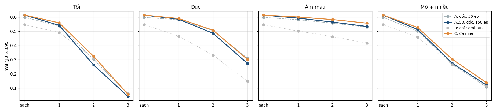

# Độ bền trên suy giảm chưa thấy khi train

Notebook: [`notebooks/robustness_unseen.ipynb`](../notebooks/robustness_unseen.ipynb), sinh từ [`notebooks/tools/make_robust_nb.py`](../notebooks/tools/make_robust_nb.py).

Lần chạy trên Kaggle: [robustness-unseen](https://www.kaggle.com/code/phanlvnminh/robustness-unseen), version 1. GPU T4, chạy 59 phút, không train thêm detector nào.

Các bảng trong `results/robust/` chép từ output notebook, làm tròn 4 chữ số (tỉ lệ giữ lại 3 chữ số). `robustness_curves.png` được vẽ lại từ chính các số này, cùng kiểu với hình trong notebook.

## Câu hỏi

Theo [domain_detectors.md](domain_detectors.md), detector đa miền **C** ngang detector chỉ học ảnh gốc **A150** trên ảnh gốc và bền hơn khi ảnh test là SCNet hoặc Semi-UIR. Nhưng C đã được train trên chính hai miền này.

Câu hỏi ở đây: C chỉ **quen** hai miền đã học, hay bền hơn với **thay đổi miền nói chung**?

## Thiết lập

- **Detector:** dùng lại 4 trọng số đã có.
  - A: chỉ ảnh gốc, 50 epoch.
  - A150: chỉ ảnh gốc, 150 epoch. Có cùng số lượt ảnh với C nên là **đối chứng chính**.
  - B: chỉ Semi-UIR, 50 epoch.
  - C: đa miền, gồm gốc, SCNet và Semi-UIR, 50 epoch.
- **Ảnh test:** 4.200 ảnh test gốc của RUOD. Mỗi ảnh được áp 4 kiểu suy giảm × 3 mức nặng. Đây chỉ là biến đổi màu và độ sáng, không đổi hình học, nên nhãn hộp giữ nguyên. **Không detector nào thấy các kiểu này khi train.**

| Kiểu | Mô phỏng | Mức 1 → 3 |
|---|---|---|
| `dark` | Thiếu sáng: gamma, giảm độ sáng, nhiễu cảm biến | độ sáng còn 45% → 18% |
| `turbid` | Nước đục: I = J·t + B·(1 − t) với màn xanh xám, kèm mờ Gauss | t = 0,60 → 0,30 |
| `cast` | Ám màu theo độ sâu: t_c = exp(−β_c·d), kênh đỏ mất nhanh nhất | d = 2 → 7 m |
| `blur` | Mờ chuyển động, nhiễu và nén JPEG | kernel 5 → 15 px, JPEG 60 → 25 |

`turbid` và `cast` là dạng đơn giản của mô hình tạo ảnh dưới nước (Jaffe–McGlamery; Akkaynak & Treibitz). Seed được cố định theo cặp (điều kiện, ảnh), nên mọi detector nhận đúng cùng một ảnh suy giảm.

- **Chấm điểm:** tính mAP@0.5:0.95 bằng pycocotools. Paired bootstrap 1.000 lần trên hiệu mAP từng ảnh C − A150 cho hai đại lượng:
  - **delta:** hiệu mAP giữa hai detector trong cùng điều kiện.
  - **chênh mức tụt:** (mức tụt của C) − (mức tụt của A150) so với ảnh sạch. Dương nghĩa là C tụt ít hơn.
- **Tự kiểm tra:**
  - mAP từng ảnh tính nhanh khớp với cách gọi pycocotools từng ảnh; chênh lớn nhất 2·10⁻¹⁶ trên 30 ảnh.
  - Trên ảnh sạch, C = 0,6155 và A150 = 0,6151, khớp `domain_detectors.md` (0,6155 và 0,6150).

## Kết quả chính: C với A150

| Điều kiện | A | A150 | B | **C** | C − A150 [CI 95%] | Chênh mức tụt [CI 95%] |
|---|---|---|---|---|---|---|
| ảnh sạch | 0,5991 | 0,6151 | 0,5476 | **0,6155** | +0,0027 [−0,0003; +0,0056] | — |
| dark1 | 0,5386 | 0,5431 | 0,4919 | **0,5606** | +0,0181 [+0,0146; +0,0218] | +0,0153 [+0,0116; +0,0193] |
| dark2 | 0,3041 | 0,2632 | 0,3110 | **0,3245** | +0,0664 [+0,0611; +0,0717] | +0,0637 [+0,0574; +0,0700] |
| dark3 | 0,0555 | 0,0402 | 0,0634 | 0,0554 | +0,0295 [+0,0247; +0,0346] | +0,0268 [+0,0211; +0,0325] |
| turbid1 | 0,5824 | 0,5861 | 0,4668 | **0,5912** | +0,0067 [+0,0034; +0,0100] | +0,0040 [+0,0009; +0,0071] |
| turbid2 | 0,5060 | 0,4867 | 0,3326 | **0,5086** | +0,0193 [+0,0150; +0,0234] | +0,0165 [+0,0120; +0,0212] |
| turbid3 | 0,3099 | 0,2738 | 0,1476 | 0,3020 | +0,0274 [+0,0220; +0,0323] | +0,0246 [+0,0184; +0,0305] |
| cast1 | 0,5824 | 0,5939 | 0,5028 | **0,6018** | +0,0072 [+0,0039; +0,0102] | +0,0045 [+0,0015; +0,0072] |
| cast2 | 0,5587 | 0,5662 | 0,4633 | **0,5838** | +0,0165 [+0,0130; +0,0198] | +0,0138 [+0,0102; +0,0175] |
| cast3 | 0,5303 | 0,5349 | 0,4179 | **0,5584** | +0,0248 [+0,0210; +0,0287] | +0,0220 [+0,0181; +0,0262] |
| blur1 | 0,5028 | 0,5142 | 0,4596 | **0,5280** | +0,0175 [+0,0141; +0,0215] | +0,0148 [+0,0109; +0,0193] |
| blur2 | 0,2709 | 0,2768 | 0,2655 | **0,3050** | +0,0251 [+0,0199; +0,0304] | +0,0224 [+0,0165; +0,0286] |
| blur3 | 0,1064 | 0,1212 | 0,1145 | **0,1383** | +0,0093 [+0,0036; +0,0148] | +0,0066 [+0,0005; +0,0132] |

In đậm là giá trị cao nhất mỗi hàng. Các cột delta và chênh mức tụt là trung bình mAP từng ảnh, nên lệch nhẹ so với hiệu của mAP toàn tập.

- **C hơn A150 có ý nghĩa thống kê ở 12/12 điều kiện suy giảm.** Khoảng tin cậy của cả delta lẫn chênh mức tụt đều nằm hoàn toàn trên 0. A150 không hơn C ở điều kiện nào.
- Trên ảnh sạch hai detector ngang nhau, CI chứa 0. Vậy C bền hơn mà **không phải đánh đổi** độ chính xác trên ảnh gốc.
- **Tỉ lệ giữ lại** trung bình trên 12 điều kiện là C 0,685 và A150 0,650.
- **Mức lợi lớn nhất** là ở mức nặng vừa: dark2 +0,066 (C 0,3245 so với A150 0,2632, tức +23% tương đối), turbid3 +0,027, blur2 +0,025, cast3 +0,025.

## Quan sát phụ

- **Train lâu hơn trên ảnh gốc làm detector kém bền.** A150 hơn A trên ảnh sạch (+0,016) nhưng thua A ở dark2, dark3, turbid2 và turbid3. Detector học thêm 100 epoch trên một miền thì khớp miền đó hơn và kém đi khi miền thay đổi. C dùng cùng ngân sách train nhưng chia cho 3 miền, nên vẫn tăng trên ảnh sạch như A150 mà không mất độ bền.
- **C với A (50 epoch):** C cao hơn ở 10/12 điều kiện. A nhỉnh hơn ở turbid3 (0,3099 so với 0,3020) và ngang ở dark3 (0,0555 so với 0,0554). Notebook không tính CI cho cặp này; cặp so sánh công bằng về chi phí là C với A150.
- **B (chỉ Semi-UIR)** tốt nhất ở dark2 và dark3, có lẽ vì ảnh Semi-UIR đã được tăng sáng. Nhưng B kém nhất ở mọi mức `turbid` và `cast`, và thua 0,068 trên ảnh sạch. Detector một miền chỉ bền với kiểu ảnh giống miền nó học.
- **dark3 gần như phá hỏng mọi detector** (mAP ≤ 0,064). Đây là mức sàn: các con số dương ở hàng này có ý nghĩa thống kê nhưng nhỏ về tuyệt đối.

## Kết luận

Train trộn ảnh gốc với ảnh tăng cường không chỉ giúp detector quen hai miền SCNet và Semi-UIR. Nó còn làm detector **bền hơn với các kiểu suy giảm chưa từng thấy**: tối, đục, ám màu, mờ và nhiễu. Lợi ích có ý nghĩa thống kê ở cả 12 điều kiện, so với một detector cùng chi phí train chỉ học ảnh gốc, và không phải trả giá trên ảnh sạch.

Kết quả này củng cố kết luận chung của đề tài: **tăng cường ảnh có giá trị nhất khi dùng làm dữ liệu train, không phải làm bước tiền xử lý hay chọn ảnh lúc suy luận.**

## Hạn chế

- Suy giảm là **tổng hợp**, chưa phải ảnh dưới nước thật ở điều kiện khác. Bước tiếp nên kiểm tra trên một bộ dữ liệu khác như DUO hoặc UTDAC.
- Mỗi detector chỉ train một lần (seed 0) và chỉ dùng YOLO11n, nên chưa đo được độ dao động giữa các lần train.
- Bootstrap chỉ lấy mẫu lại theo ảnh, chưa tính dao động do train lại detector.
